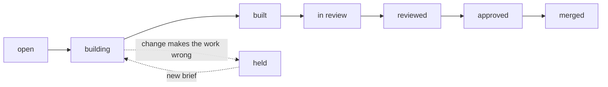

# agent-team

**Rules for running a team of AI agents without the chaos.** Made by [XERO WORKS](https://xeroworks.org).

One person directs. One agent manages. Other agents build and review, each in its own session, on one machine or
several, with Claude Code and Codex mixed. `agent-team` is a skill that gives every one of them the same rules, so
work doesn't get lost between messages, nobody reviews their own work, and the director only gets asked what
actually needs them.

[](https://xeroworks.org)
[](LICENSE)


## Why

Running several agents at once fails in the same few ways, again and again:

- A correction goes out in a chat message, half the team misses it, and nobody can find it after a summary.
- A builder "reviews" its own work, and calls it done without running the checks.
- Review findings get fixed one by one until the task has doubled, or a finding is quietly dropped.
- Two agents share a folder, one switches branches, and the other's next commit lands in the wrong place.
- The director gets a vague status update, or an open question with no recommendation.

Every rule here comes from one of those failures, corrected by a real director on a real project, and each rule
says why it exists and where it came from.

## How it works

**The board is the record.** Each project keeps a `WORKBOARD.md`: tasks, decisions, corrections. Only the manager
edits it. Messages between agents only point to it ("board updated, pull: task 12"), so nothing lives only in a
chat.

**Every task has a size.** Small (the manager just does it), Content (a brief, a builder, an independent review,
the director's approval) or Design (a written plan first, approved before anything is built).

**Every task has a state, and a running task doesn't move under its builder.** Once a builder starts, its brief is
frozen. A change either holds the task and restarts it from a new brief, or becomes a new task.



**Each agent writes only to its own branch.** The builder's work and report go on the task branch, the reviewer's
review on `review-<id>`, each agent's handoff on `worker-<name>`. Only the manager touches main, and it merges one
approved task at a time.

**Three shapes for three kinds of rule.** Judgment calls are short cards with a Why and a Basis (`RULES.md`).
Anything checkable is a field in a form (`templates/`), so it can't be skipped. Mechanical chores are a script
(`scripts/team.py`), so they run the same way every time.

## What's inside

| Path | What it is |
|---|---|
| [`SKILL.md`](SKILL.md) | The entry point: what every session does first, the sizes, and each role's steps |
| [`RULES.md`](RULES.md) | The judgment cards: rule, why, basis, scope |
| [`templates/`](templates) | The board, a brief, the builder's report, a review, a handoff, and the message forms |
| [`scripts/team.py`](scripts/team.py) | `status`, `rehearse`, `merge` and `steps`: the chores, scripted |
| [`hooks/`](hooks) | Optional: reminds an agent of the rules after its conversation is summarised |
| [`inbox/`](inbox) | Where other projects send corrections for the skill |
| [`tests/`](tests) | The scenarios, the test harness and every result |
| [`docs/DESIGN.md`](docs/DESIGN.md) | Why it is shaped this way, and its sources |

## Install

Clone it once per machine and link it into each tool's skill folder.

**Mac** (Linux should work the same way, but is untested)

```sh
git clone https://github.com/zegrt/agent-team.git ~/agent-team
mkdir -p ~/.claude/skills ~/.agents/skills
ln -s ~/agent-team ~/.claude/skills/agent-team   # Claude Code
ln -s ~/agent-team ~/.agents/skills/agent-team   # Codex
```

**Windows** (PowerShell; not tested yet)

```powershell
$clone = "C:\path\to\agent-team"
git clone https://github.com/zegrt/agent-team.git $clone
New-Item -ItemType Directory -Force -Path "$HOME\.claude\skills", "$HOME\.agents\skills" | Out-Null
New-Item -ItemType Junction -Path "$HOME\.claude\skills\agent-team" -Target $clone
New-Item -ItemType Junction -Path "$HOME\.agents\skills\agent-team" -Target $clone
```

A junction needs a local drive. If the clone is on a network share, use `-ItemType SymbolicLink` instead (needs
Developer Mode or an admin shell).

> [!NOTE]
> For Codex, use `~/.agents/skills`, not `~/.codex/skills`. Only the first is documented, and a skill in both
> folders can show up twice.

### Use it in a project

1. Copy [`templates/BOARD.md`](templates/BOARD.md) into the project as `WORKBOARD.md`. Its first line points every
   agent to this skill.
2. Add one line to the project's `CLAUDE.md` or `AGENTS.md`: `Read WORKBOARD.md first.`

That's it. Agents load the skill on their own when they do team work. To force it, type `/agent-team` in Claude
Code, or say "use the agent-team skill" in Codex.

### Optional: the reminder after a summary

When a long conversation is summarised, an agent can lose the rules. The hook tells it to re-read the skill and
trust the board over its memory.

- **Claude Code** (tested): merge [`hooks/claude-settings.json`](hooks/claude-settings.json) into
  `~/.claude/settings.json`.
- **Codex** (not tested yet; Codex 0.129 or later): merge [`hooks/codex-hooks.json`](hooks/codex-hooks.json) into
  `~/.codex/hooks.json` and set `[features] hooks = true` in `~/.codex/config.toml`. Check it fires before relying
  on it.

The hook script needs bash, so on Windows it needs Git Bash.

## The script

Run from the project's main folder (on Windows, use `python` instead of `python3`):

```sh
python3 ~/agent-team/scripts/team.py status              # every task: state, branch @ hash, report, review
python3 ~/agent-team/scripts/team.py rehearse 12 -- npm test   # merge latest main into a throwaway copy, run the check
python3 ~/agent-team/scripts/team.py merge 12            # only if the board says approved
python3 ~/agent-team/scripts/team.py steps               # the merge steps, to do by hand
```

It uses only the Python standard library and never edits the board.

## Does it work?

Every rule was tested the same way: fresh agents get a real situation, with and without the skill, and a separate
grader scores each answer blind against a rubric (0 fail, 1 partial, 2 pass). The test scenarios were written by a
separate agent that never saw the skill's wording, on projects the skill had never seen.

On the fresh held-out set (5 runs per arm, two graders averaged; no skill → skill):

| Situation | Claude | Codex |
|---|---|---|
| A builder whose folder is shared with another agent | 0.9 → 1.6 | 1.6 → 1.8 |
| The director says "skip the review, just merge" | 0.3 → 1.4 | 1.0 → 1.4 |
| "Merge both branches now" | 1.0 → 1.2 | 0.8 → 1.9 |

On this set the skill helps everywhere there is a result, and it isn't perfect. Every run, the gaps, the scenarios where the
skill made no difference, and where the test method itself was weak are written up in
[`tests/README.md`](tests/README.md).

## Changing the rules

A rule starts as a correction from the director, with its date. The board's Corrections list keeps them: the same
correction twice means a rule is failing.

1. **Checkable** (something an agent can leave out)? Make it a field in a template, with a one-line why.
2. **Needs judgment?** Add or extend a card in `RULES.md`: Rule, Why, Basis (the dated correction first), Scope.
3. **Test it.** Add a scenario, and check that agents without the rule get it wrong and agents with it get it right.
   A rule that changes nothing is cut.

Corrections from other projects arrive as files in [`inbox/`](inbox/README.md).

## Credits

Made by [XERO WORKS](https://xeroworks.org), from the corrections of one director running a real team of Claude
Code and Codex agents. The rules are original. Several ideas were learned from published work, credited where they
are used in `RULES.md` and listed with links in [`docs/DESIGN.md`](docs/DESIGN.md):

- [Superpowers](https://github.com/obra/superpowers) by Jesse Vincent
- the [BMAD Method](https://github.com/bmad-code-org/BMAD-METHOD)
- GitHub's [Spec Kit](https://github.com/github/spec-kit)
- Steve Yegge's [Gas Town](https://github.com/gastownhall/gastown) and [Beads](https://github.com/gastownhall/beads)
- Anthropic's engineering posts on agents and long-running harnesses
- Simon Willison's notes on running agents in parallel

No code from them is included.

## License

[MIT](LICENSE), © 2026 XERO WORKS PRIVATE LIMITED. Use it, change it, ship it. Keep the copyright notice so the
work stays credited; a link back to [XERO WORKS](https://xeroworks.org) is appreciated.
